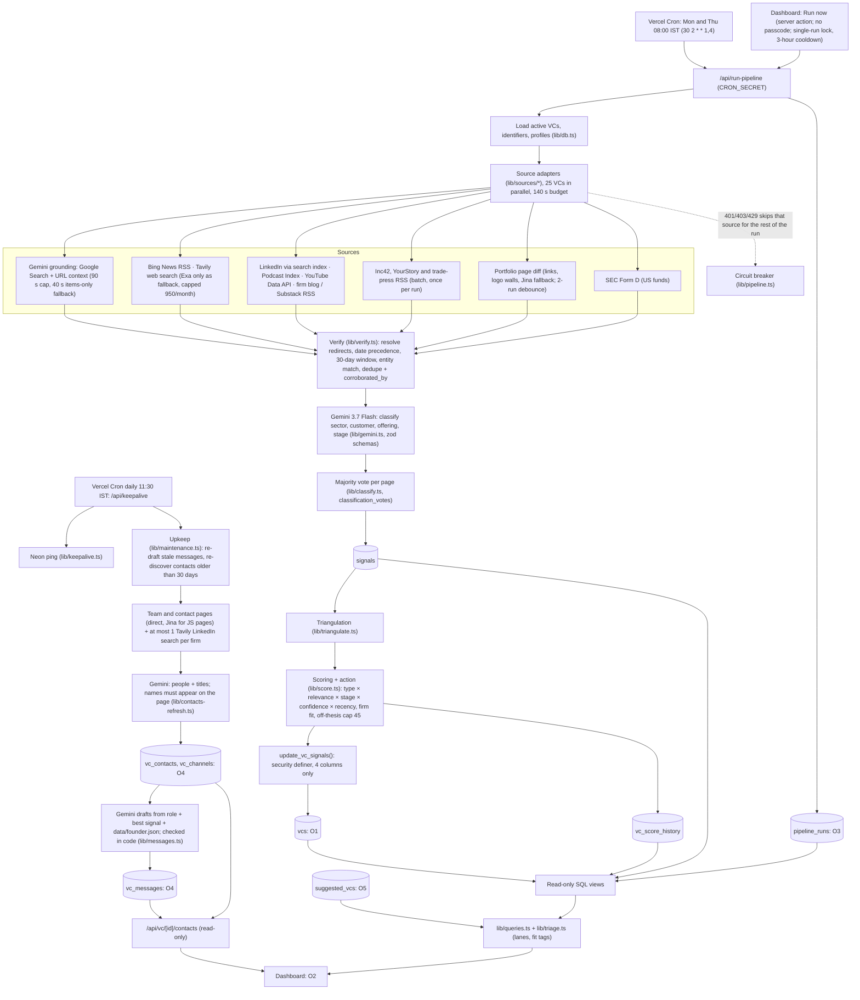
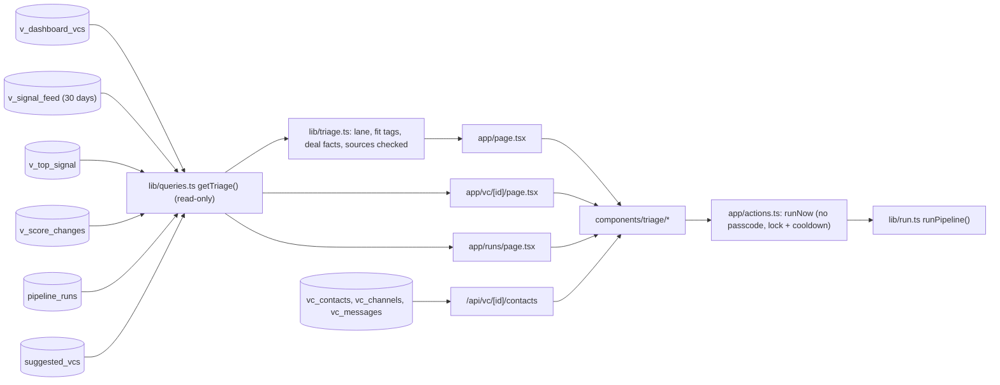

# Components Map

*Submission image: `docs/components-map.png` (updated 12 Oct 2026: triage dashboard with Focus/Board/Table/Discover, who to contact and drafted messages, daily contacts upkeep, Discover with rubric scores). Regenerate after any change with `python3 docs/tools/make-components-map.py` (needs Pillow). The tables and diagrams below are the detailed version.*

Every component has one responsibility, a file path, and a clear input and output. The **dashboard** is one of the system's outputs and is mapped in §3. Live site: https://vc-pipeline-lovat.vercel.app

## 1. System outputs

| # | Output | Who uses it | Where it lives |
|---|---|---|---|
| O1 | **Neon Postgres `vcs` table** with the four signal columns (`last_signal_date`, `signal_summary`, `follow_up_score`, `recommended_action`) refreshed each run. System of record; Vikram's columns untouched | Vikram, any tool he connects | Neon project `vc-pipline` (`noisy-surf-05848493`), AWS us-east-2 |
| O2 | **Dashboard**: who to message today and why, follow-ups, maybes, parked; evidence; who to contact at each firm with drafted messages; suggested investors not on the list | Vikram (and graders) | Vercel public URL, no login |
| O3 | **Run log**: per-source counts, errors, usage, trigger type, duration | Vikram, graders, debugging | `pipeline_runs` + `/runs` page |
| O4 | **Who to contact + drafts**: people from each firm's team page with POC level and published links, plus an email, LinkedIn note and follow-up per top contact | Vikram | `vc_contacts`, `vc_channels`, `vc_messages`; shown in the dashboard workspace |
| O5 | **Suggestions**: active B2B-logistics seed investors not on the list, ranked by the swap rubric | Vikram | `suggested_vcs`; Discover tab |
| O6 (v2) | Email/Telegram digest before he starts work | Vikram | Scheduled job |

## 2. System architecture

## 3. Dashboard component map (output O2)

> Visual design, layout, copy and tokens are specified in `docs/dashboard-design.md` §3–§5. Where the two disagree, the design spec wins.

### 3.1 Data flow

### 3.2 Pages and routes

| Route | Purpose | Data | Key elements |
|---|---|---|---|
| `/` | The answer: who to message today, and why | `getTriage()` | Top bar · briefing band (headline, since-last-run line, yard map) · Focus / Board / Table / Discover views. `?view=` and `?vc=` keep the view and selected investor in the URL |
| `/vc/[id]` | One investor, full page | `getTriage()` row + `getVcDetail()` | The same workspace at full width, plus every signal on record |
| `/runs` | Proof the data is live | `pipeline_runs` | Run list: started, trigger, result, investors, new signals, per-source counts, errors |
| `/api/vc/[id]/contacts` | People, firm routes and drafts for one firm | `vc_contacts`, `vc_channels`, `vc_messages` | JSON, GET only, cached 60 s |
| `/api/run-pipeline` | Scheduled run | everything | `CRON_SECRET` required |
| `/api/run-now` | Manual run for scripts | everything | `CRON_SECRET` required |
| `/api/keepalive` | Daily Neon ping + upkeep | `vcs`, contacts tables | `CRON_SECRET` required |

### 3.3 Components (`components/`)

| Component | Responsibility | Props / data |
|---|---|---|
| `triage/TopBar` | Logo, view tabs (Focus, Board, Table, Discover), status pill ("Checked N of N sources. Updated …", links to `/runs`), search modal (`/` or Cmd+K; arrows, Enter, Esc), Demo, theme toggle, Run now | `items`, `pill`, `running`, `view`/`onView` on the home page |
| `triage/Briefing` | Headline sentence (counts only *Message today*), subline (follow-ups, maybes), since-last-run line (new signals, biggest mover, how many went quiet), yard map (50 squares, 10 columns, sorted by lane; click selects, hover/focus names, arrow keys move with one tab stop; load animation), legend chips that filter | rows, `Since` |
| `triage/Triage` | Client root: view, selection, lane filter, parked toggle, phone sheet, toast, URL sync; keyboard `j`/`k` move, `c` copies, Esc closes the sheet. Holds the `Queue`, `Board`, `Table` (sortable, filterable) and `Discover` views | `getTriage()` result |
| `triage/Workspace` | One investor: name, partner, region, *Yours* lock chip, lane tag; **Why now** (lead sentence, deal facts: company, round, size, role, date; or type, published, where), lane reason; **Does it fit you?** (Seed, B2B, Logistics, Software: filled, half, hollow, with text); **Activity in the last 30 days** (tape); **Evidence** (date and link checked, deduplicated by link and site, "Confirmed by 2 sources", other activity folded); **What to say** (opening or nudge line, Copy, `c`); **Who to contact**; **The firm**; **How the score works** (folded); **Your notes** (locked, read-only) | `TriageRow` |
| `triage/WhoToContact` | Firm routes (pitch form, published firm emails, contact page); people ranked by POC level (decision-maker, partner, principal, associate) with title, focus, LinkedIn/X/email/team-page links; drafts (email, LinkedIn note, follow-up) with Copy, Open in email, Open LinkedIn. Loaded when an investor opens | `/api/vc/[id]/contacts` |
| `triage/InvestorPage` | `/vc/[id]` layout: top bar, back link, workspace (page mode, `h1`), every signal on record | row, signals |
| `triage/labels.ts` | Copy deck: lane names, queue line ("Co-led Lantern · Seed · $7.0 million"), dates, *Yours* text, lane reasons, plain-English profile values | — |
| `RunNowButton` | Confirm dialog, runs the pipeline via the server action, shows a per-source checklist and the result; no passcode | server action |
| `ThemeToggle` | Light/dark switch; follows the system until clicked; stored in `localStorage` and applied before paint | — |
| `DemoTour` | 19-step guided tour of the real page: the answer, the map, the queue, the workspace (why now, fit, tape, evidence, line, contacts, drafts, notes), Board, Table, Discover, search, run history, theme, Run now. Highlights each element, performs the clicks, restores the theme at the end | — |

### 3.4 Lanes (single source of truth in `lib/triage.ts`, unit-tested)

The pipeline stores `recommended_action` (rules from `signal-sources.md` §8.4, in `lib/score.ts`). The dashboard adds the fit check and groups rows into four lanes:

| Lane | Rule | Shown as |
|---|---|---|
| **Message today** | score ≥ 60, not already waiting, fit confirmed | Amber; ranked; counted in the headline |
| **Waiting on a reply, with something new to say** | Vikram is waiting, the pipeline says nudge (*Nudge now* or *Light nudge*), fit confirmed | Blue, notched squares |
| **Maybe, if you have time** | score 30–59; or ≥ 60 without a confirmed fit; or waiting but contacted recently (*Hold*) | Grey |
| **Parked** | score < 30 or no signal in 30 days | Dark, flat squares; collapsed |

**Fit confirmed** = B2B and Logistics filled, and Seed and Software not hollow. Tags come from the lead signal: Seed (pre-seed/seed/seed-extension = filled; no round stated = half if the firm does seed), B2B (`b2b` filled, `b2b2c`/unknown half, `b2c` hollow), Logistics (`fit` filled, `partial` half), Software (`software` filled; marketplace, fintech, unknown half; hardware, asset-heavy, services hollow).

### 3.5 Dashboard rules

- **Read-only.** No page, component or route writes to any table. The only write path is the Run now server action, which starts the pipeline.
- **Server-side data.** Queries run on the server as `vc_runtime`; the browser gets rendered HTML and the contacts JSON only. No keys reach the browser.
- **Run now has no passcode** (owner's decision, so the professor can use it). Guarded by a single-run lock (a `pipeline_runs` row unfinished and started within 10 minutes) and a 3-hour cooldown.
- **Never blank.** Calm status wording; if the last full run failed, the pill says so and the last good data stays on screen.
- **Every message-worthy row shows evidence** with a checked link and date.
- **Demo data labelled.** Vikram's notes, status and contact history keep their `[DEMO]` prefix and sit in a locked panel.
- **Contacts are public data only.** Names must appear on the firm's own page; emails only when the firm publishes them on its own domain; Cloudflare-hidden emails are not decoded. Nothing is sent from the page.
- **Accessibility.** WCAG AA in both themes (axe-core: 0 violations on every view at 390 and 1440 px, light and dark); never color alone; keyboard paths for everything; reduced motion respected.
- **Public URL caveat.** No login in v1 because the founder data is demo data; the SaaS version needs authentication and per-founder row security.

### 3.6 Read model (views and tables the dashboard reads)

| Object | Kind | Used for |
|---|---|---|
| `v_dashboard_vcs` | view (archived rows excluded) | Firm, partner, region, Vikram's columns, score, action, firm profile |
| `v_signal_feed` | view | Signals with fit axes, evidence quotes, corroboration |
| `v_top_signal` | view | Lead signal per VC (highest `signal_value`), opening and nudge lines |
| `v_signal_tape` | view | 30-day activity |
| `v_score_changes` | view | Since-last-run mover and quiet counts |
| `pipeline_runs` | table | Status pill, since line, `/runs` |
| `suggested_vcs` | table (`rubric_score`, `deal_count`, `summary`, `caveat`) | Discover |
| `vc_contacts`, `vc_channels`, `vc_messages` | tables | Who to contact and drafts |

## 4. Component table (submission format)

| ID | Component | Responsibility | Tech | Input | Output | File |
|---|---|---|---|---|---|---|
| C1 | Scheduler | Twice-weekly run; daily keep-alive and upkeep | Vercel Cron (region `cle1`, 300 s functions) | Cron expressions | HTTP calls with `CRON_SECRET` | `vercel.json` |
| C2 | Pipeline orchestrator | Loads VCs, runs 25 in parallel within a time budget, isolates errors, circuit breaker, single-run lock, logs the run | Next.js route handler | Trigger | Calls C3–C9; writes `pipeline_runs` | `app/api/run-pipeline/route.ts`, `lib/run.ts`, `lib/pipeline.ts` |
| C3 | Source adapters | Fetch live items: Bing News RSS, firm RSS, LinkedIn index, YouTube Data API, Podcast Index, SEC Form D, batch feeds | `fetch`, `rss-parser`, `cheerio` | VC identifiers, 30-day window | `RawItem[]` | `lib/sources/*` |
| C3b | Web search | Tavily first (free, capped 950/month), Exa only as a small fallback | Tavily API, Exa API | Query | Dated hits | `lib/search.ts` |
| C4 | Verifier | Resolve redirects, date precedence, 30-day window, entity match, dedupe and corroboration | TypeScript | `RawItem[]` | Verified items | `lib/verify.ts` |
| C5 | Gemini client | Only AI entry point: Google Search + URL context + structured JSON | `@google/genai` (Gemini 3.7 Flash) | Items + VC context | zod-validated output | `lib/gemini.ts`, `lib/sources/gemini-grounding.ts` |
| C6 | Portfolio differ | Snapshot, hash, diff, 2-run debounce (links or logo walls; Jina fallback) | `cheerio`, Jina Reader | Portfolio page | Added companies | `lib/sources/portfolio-diff.ts`, `lib/portfolio.ts` |
| C6b | Classification vote | Majority vote over repeated Gemini verdicts per page | TypeScript | Stored + new verdict | Stable classification | `lib/classify.ts` |
| C7 | Scoring engine | Relevance, stage and firm-fit multipliers, triangulation, 0–100 score, action, summary | TypeScript | Signals + profile + status | Score, action, summary | `lib/score.ts`, `lib/triangulate.ts` |
| C8 | Data access layer | Typed DB helpers as the app role | `@neondatabase/serverless` as `vc_runtime` | Queries | Rows | `lib/db.ts`, `lib/sql.ts` |
| C9 | Protected write functions | Column-restricted updates that can't touch Vikram's columns; app role has no UPDATE/DELETE on `vcs` | Postgres roles + `security definer` | Score fields / identifiers | Updated `vcs` row | `db/migrations/0001`–`0003` |
| C10 | Read model | Read-only views for the UI, archived rows excluded | Postgres views | Tables | Dashboard rows | `db/migrations/*` |
| C11 | Query and triage layer | `getTriage()`: lanes, fit tags, deal facts, deduplicated evidence, score parts; status pill and since line | TypeScript | Views | `TriageRow[]` | `lib/queries.ts`, `lib/triage.ts`, `lib/status.ts` |
| C12 | Dashboard | Pages and components in §3 | Next.js 16 App Router, React | C11, C20 | Triage UI | `app/*`, `components/triage/*` |
| C13 | Run-now action | Manual trigger, no passcode; lock + 3-hour cooldown | Next.js server action | Click | Starts C2 | `app/actions.ts` |
| C14 | Seed, profile and swap scripts | Load the list, resolve identifiers, profile funds; reverse lookup and roundup discovery; rubric swap (archive, undo); export; suggestions with rubric score | `tsx` scripts + Tavily/Exa + Gemini | `data/*.csv`, `data/*.json` | `vcs`, `vc_profiles`, `suggested_vcs`, `docs/swap-log.md` | `scripts/*`, `lib/rubric.ts` |
| C15 | Data store | System of record | Neon Postgres (AWS us-east-2) | — | — | Neon `vc-pipline` |
| C16 | Keep-alive | Daily query so the database is always in use | Vercel Cron + route | — | Ping result | `app/api/keepalive/route.ts`, `lib/keepalive.ts` |
| C17 | Contact discovery | Team and contact pages → people with titles (names verified on the page), POC level, ranking, LinkedIn/X links, firm-domain emails, pitch form, contact page | `cheerio`, Jina, Gemini, ≤ 1 Tavily search per firm | Firm website | `vc_contacts`, `vc_channels` | `lib/contacts.ts`, `lib/contacts-refresh.ts` |
| C18 | Message drafting | Email, LinkedIn note (≤ 300 chars), follow-up for the top 2 contacts, from role, best signal and `data/founder.json`; rules checked in code, one retry | Gemini + TypeScript | Contact, signal, founder | `vc_messages` | `lib/messages.ts` |
| C19 | Upkeep | Re-draft messages whose signal changed; re-discover contacts older than 30 days (≤ 10/day) | TypeScript | DB state | Fresh contacts and drafts | `lib/maintenance.ts` |
| C20 | Contacts API | Read-only JSON for the workspace | Next.js route handler | VC id | Contacts, channels, drafts | `app/api/vc/[id]/contacts/route.ts` |
| C21 | Theme and demo | Light/dark toggle with no flash; 19-step guided tour | React client components | — | — | `components/ThemeToggle.tsx`, `components/DemoTour.tsx`, `app/layout.tsx` |
| C22 | Proofs and UI checks | Requirement proofs (R1–R12), screenshots, axe-core, Lighthouse, Playwright | `tsx`, `playwright-core`, `axe-core` | Live DB and site | `docs/proofs/*` | `scripts/proofs.ts`, `scripts/ui-checks.ts`, `scripts/ui-screens.ts` |

## 5. Trust boundaries

| Boundary | Rule |
|---|---|
| Browser ↔ server | Browser gets rendered HTML and the contacts JSON only. No API keys, no database URL, no `CRON_SECRET`. |
| App ↔ `vcs` | The app connects as `vc_runtime` (no UPDATE/DELETE on `vcs`). Writes go only through `update_vc_signals` and `update_vc_identifiers` (C9). `neondb_owner` is used for migrations only. |
| Dashboard ↔ database | No write path at all; Run now only starts the pipeline. |
| Model ↔ database | Gemini output is zod-validated and re-checked in code (URL, date, entity; names on the page; draft rules) before storage. |
| Scraping | Public pages and APIs only; robots.txt respected (hence Bing News and the YouTube Data API); descriptive User-Agent; no logged-in automation. |
| Outreach | Nothing is sent automatically. Emails shown only when the firm publishes them on its own domain. |

## 6. Requirement coverage

| Booklet requirement | Components |
|---|---|
| Live external data | C3, C3b, C5, C6 |
| Gemini Flash only | C5 (sole AI entry point; ESLint blocks other AI SDKs) |
| Twice-weekly refresh | C1, C2 |
| Database (Neon) reflects current state | C7, C8, C9, C15, C16 |
| Manual notes untouched | C9, C8 (app role can't update `vcs`), C12 (read-only, locked panel) |
| Quiet VCs reported | C11 (Parked lane), C12 (collapsed Parked list, Board, Table) |
| Observable signal with why | C4, C5, C12 (Why now, evidence, fit tags) |
| Who to contact and what to say | C17, C18, C19, C20, C12 |
| Deployed on Vercel with public URL | C1, C12 |
