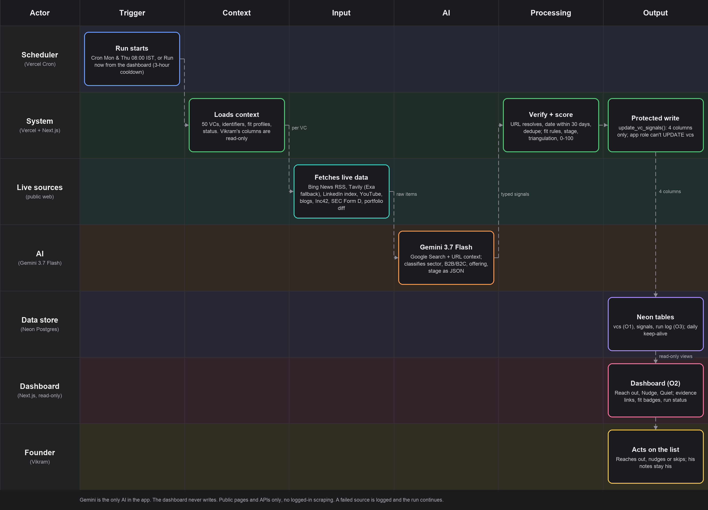
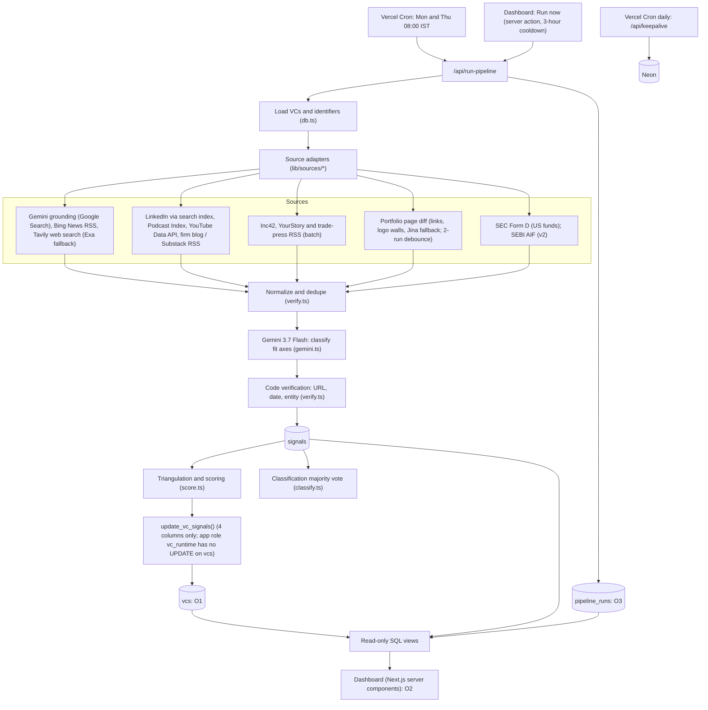
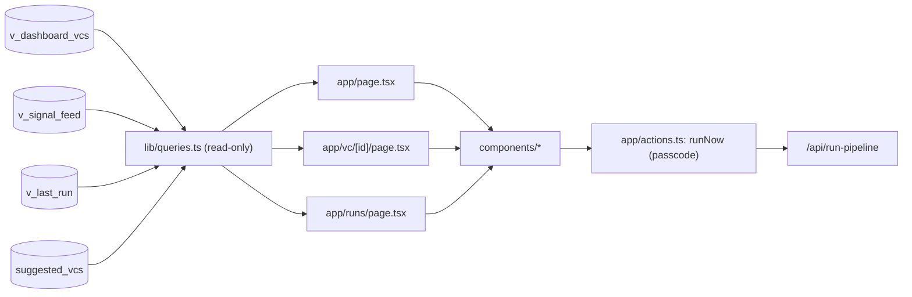

# Components Map



*Submission image: `docs/components-map.png` (updated 11 Oct 2026: Neon, Tavily-first search, Bing News RSS, no-passcode Run now). Regenerate after any change with `python3 docs/tools/make-components-map.py` (needs Pillow). The tables and diagrams below are the detailed version.*

The submission deliverable. Every component has one responsibility, a file path, and a clear input and output. The **dashboard** is one of the system's three outputs and is mapped in §3.

## 1. System outputs

| # | Output | Who uses it | Where it lives |
|---|---|---|---|
| O1 | **Neon Postgres `vcs` table** with the four signal columns refreshed each run (system of record; Vikram's notes untouched) | Vikram, any tool he connects | Neon (project `vc-pipline`) |
| O2 | **Dashboard**: ranked "who to contact this week and why", quiet list, evidence links, run status | Vikram (and graders) | Vercel public URL |
| O3 | **Run log**: per-source counts, errors, usage, trigger type | Vikram, graders, debugging | `pipeline_runs` + `/runs` page |
| O4 (v2) | Email/Telegram digest before he starts work | Vikram | Scheduled job |

## 2. System architecture



## 3. Dashboard component map (output O2)

> Visual design, layout, copy, tokens and the extra read-model SQL are specified in `docs/dashboard-design.md`. Where the two disagree, the design spec wins.

### 3.1 Data flow



### 3.2 Pages

| Route | Purpose | Data | Key elements |
|---|---|---|---|
| `/` | The answer: who to contact this week | `v_dashboard_vcs`, `v_last_run`, `suggested_vcs` | Status bar · summary tiles · bucket tabs · filter bar · VC rows |
| `/vc/[id]` | Why this VC is ranked where it is | `v_dashboard_vcs`, `v_signal_feed` | Signal timeline with evidence quotes · fit axes · firm profile · Vikram's notes and contact history (read-only) |
| `/runs` | Proof the data is live and the system is healthy | `pipeline_runs` | Run list, per-source counts, errors, trigger (cron or manual) |

### 3.3 Components (`components/`)

| Component | Responsibility | Props / data |
|---|---|---|
| `RunStatusBar` | Last successful run time, trigger, VCs processed, error count; a warning if the last run failed (but still shows the last good data) | `v_last_run` |
| `RunNowButton` | Asks for the demo passcode, calls the `runNow` server action, shows progress and per-source result | server action |
| `SummaryTiles` | Counts per bucket, signals found this run, sources active | derived |
| `BucketTabs` | Switches between **Reach out this week**, **Nudge now**, **Quiet**, **Suggested VCs** | bucket enum |
| `FilterBar` | Filters by priority (P1–P3), region (India/Global), source tier, signal type | URL search params |
| `VcRow` | One VC: firm and partner, status badge, `ScoreBar`, recommended action, one-line summary, signal date, `SourceChips`, `FitBadges` | row from `v_dashboard_vcs` |
| `ScoreBar` | 0–100 score with colour bands (≥60, 30–59, <30) | number |
| `SourceChips` | Clickable links to each evidence URL, labelled by source tier (A/B/C/D) | signals |
| `FitBadges` | Sector, customer (B2B/B2C), offering, stage; shows why a signal is "direct" or "adjacent" | signal fields |
| `CorroborationBadge` | "Confirmed by two sources" or "Low confidence: capped" (the triangulation proof) | `corroborated_by` |
| `SignalTimeline` | All signals for one VC in date order with evidence quote and tier | `v_signal_feed` |
| `FirmProfileCard` | Seed behaviour, B2B-logistics thesis, typical cheque, geography | `vc_profiles` |
| `PipelineStrip` | 50 squares colored by bucket; click jumps to the row | `v_dashboard_vcs` |
| `SignalTape` | 30-day strip of signal days; the dashboard's signature visual | `v_signal_tape` |
| `ChangesPanel` / `SuggestedPanel` | Right rail: changes since last run; investors not yet on the list | `v_score_changes`, `suggested_vcs` |
| `CopyLineButton` | Copies the opening or nudge line; no database write | `v_top_signal` |
| `EmptyState` | Never a blank page: "No new signals this week" with the last known signal date | — |

### 3.4 Bucket rules (single source of truth in `lib/types.ts`)

`recommended_action` is stored as one of these exact strings; the dashboard groups on them, so `score.ts` and the UI must share the constants.

| `recommended_action` value | Dashboard bucket | Rule (from `signal-sources.md` §8.4) |
|---|---|---|
| `Reach out this week` | Reach out | score ≥ 60 and status = yet to reach out |
| `Reach out if capacity allows` | Reach out (lower) | 30–59 and yet to reach out |
| `Nudge now` | Nudge | score ≥ 60 and waiting for response |
| `Light nudge` | Nudge (lower) | 30–59, waiting, last contact > 14 days |
| `Hold` | Parked | 30–59 waiting, contacted recently |
| `Quiet: deprioritize this week` | Quiet | score < 30 or no signal in 30 days |

### 3.5 Dashboard rules

- **Read-only.** The dashboard never writes to `vcs`, `signals` or any table. It reads only through the views below. (Editing Vikram's notes from the UI is a v2 feature and would use its own separate RPC.)
- **Server components only.** Queries run on the server with the service-role key; nothing sensitive goes to the browser.
- **Run now is protected.** The button calls a server action that checks `DEMO_PASSCODE`; `CRON_SECRET` is never exposed to the client. Only one run may be active at a time (reject if a `pipeline_runs` row has `finished_at is null` and started within 10 minutes).
- **Never blank.** If the latest run failed, show the last successful run's data with a warning.
- **Every row shows evidence.** A "reach out" row without at least one source link is a bug.
- **Demo data labelled.** Notes and contact history display with their `[DEMO]` prefix.
- **Public URL caveat.** The assignment requires a public URL, so the page has no login in v1. Because notes are demo data this is acceptable; for the SaaS version, add authentication and row-level security per founder.

### 3.6 Read-model SQL (add as a migration)

```sql
alter table public.vcs
  add column if not exists partner_name text,
  add column if not exists priority text,
  add column if not exists region text,
  add column if not exists needs_review boolean default false;

alter table public.signals add column if not exists corroborated_by text;

alter table public.vcs enable row level security;
alter table public.signals enable row level security;
alter table public.vc_profiles enable row level security;
alter table public.portfolio_snapshots enable row level security;
alter table public.pipeline_runs enable row level security;
alter table public.suggested_vcs enable row level security;
-- No anon/authenticated policies: only the server (service role) reads or writes.

create or replace view public.v_dashboard_vcs as
select v.id, v.name, v.partner_name, v.firm, v.priority, v.region,
       v.status, v.last_contact_date, v.contact_history, v.personal_notes,
       v.last_signal_date, v.signal_summary, v.follow_up_score,
       v.recommended_action, v.updated_by_system_at,
       p.does_seed, p.b2b_logistics_thesis, p.investor_type, p.typical_check, p.geo_focus,
       (select count(*) from public.signals s
         where s.vc_id = v.id and s.published_date >= current_date - 30) as signals_30d
from public.vcs v
left join public.vc_profiles p on p.vc_id = v.id;

create or replace view public.v_signal_feed as
select s.id, s.vc_id, v.firm, s.signal_type, s.summary, s.source_url, s.source_name,
       s.source_tier, s.published_date, s.evidence_quote, s.company_name,
       s.round_stage, s.sector_fit, s.customer_type, s.offering_type,
       s.logistics_relevance, s.confidence, s.corroborated_by
from public.signals s join public.vcs v on v.id = s.vc_id;

create or replace view public.v_last_run as
select * from public.pipeline_runs
order by started_at desc limit 1;
```

## 4. Component table (submission format)

| ID | Component | Responsibility | Tech | Input | Output | File |
|---|---|---|---|---|---|---|
| C1 | Scheduler | Triggers twice-weekly run | Vercel Cron | Cron expression | HTTP call with `CRON_SECRET` | `vercel.json` |
| C2 | Pipeline orchestrator | Loads VCs, batches work, isolates errors, logs the run | Next.js route handler | Trigger | Calls C3–C9; writes `pipeline_runs` | `app/api/run-pipeline/route.ts` |
| C3 | Source adapters | Fetch live items from each channel (Bing News RSS, firm RSS, LinkedIn index, YouTube, SEC, batch feeds) | `fetch`, `rss-parser`, `cheerio` | VC identifiers, time window | `RawItem[]` | `lib/sources/*` |
| C3b | Web search | Tavily first (free, capped 950/month), Exa only as small fallback | Tavily API, Exa API | Query | Dated hits | `lib/search.ts` |
| C4 | Normalizer and verifier | Resolve redirects, check dates ≤ 30 days, dedupe, entity match | TypeScript | `RawItem[]` | Verified items | `lib/verify.ts` |
| C5 | Gemini client | Google Search + URL context + structured JSON; only AI entry point | `@google/genai` (Gemini 3.7 Flash) | Items + VC context | Classified signals (zod-validated) | `lib/gemini.ts` |
| C6 | Portfolio differ | Snapshot, hash, diff, debounce (links or logo walls) | `cheerio`, Jina Reader | Firm portfolio page | Added/removed companies | `lib/sources/portfolio-diff.ts` |
| C6b | Classification vote | Majority vote over repeated Gemini verdicts per page | TypeScript | Stored + new verdict | Stable classification | `lib/classify.ts` |
| C7 | Scoring engine | Fit axes → relevance, stage and firm multipliers, triangulation, action | TypeScript | Signals + `vc_profiles` + status | Score, summary, action | `lib/score.ts` |
| C8 | Data access layer | Typed DB helpers; only writer to `vcs` is the protected function | `@neondatabase/serverless` as `vc_runtime` | Scores | 4 columns updated | `lib/db.ts`, `lib/sql.ts` |
| C9 | Protected write function | Column-restricted update that cannot touch Vikram's notes; app role has no UPDATE/DELETE on `vcs` | Postgres roles + `security definer` functions | Score fields | Updated `vcs` row | `db/migrations/*` |
| C10 | Read model | Read-only views for the UI (archived rows excluded) | Postgres views | Tables | Dashboard rows | `db/migrations/*` |
| C11 | Query layer | Typed read-only queries used by pages | `@neondatabase/serverless` | Views | Typed rows | `lib/queries.ts` |
| C12 | Dashboard | Pages and components in §3 | Next.js App Router, React server components | Views | Ranked, explained pipeline | `app/*`, `components/*` |
| C13 | Run-now action | Manual trigger, no passcode; single-run lock + 3-hour cooldown | Next.js server action | Click | Starts C2 | `app/actions.ts` |
| C14 | Seed, profile and swap scripts | Load the VC list, resolve identifiers, profile funds; reverse lookup, rubric swap (archive, undo), export | `tsx` scripts + Exa + Gemini | `data/vc-seed-list.csv` | Populated `vcs`, `vc_profiles`, `suggested_vcs` | `scripts/*` |
| C15 | Data store | System of record | Neon Postgres (AWS us-east-2) | — | — | Neon |
| C16 | Keep-alive | Daily query so the database is always in use | Vercel Cron + route | — | Ping result | `app/api/keepalive/route.ts` |

## 5. Trust boundaries

| Boundary | Rule |
|---|---|
| Browser ↔ server | Browser gets rendered HTML only. No API keys, no service-role key, no `CRON_SECRET`. |
| App ↔ `vcs` | Writes only through `update_vc_signals` (C9). Dashboard has no write path at all. |
| Model ↔ database | Gemini output is validated with zod and re-checked in code (URL, date, entity) before storage. |
| Scraping | Only public pages and APIs; descriptive User-Agent; no logged-in automation. |

## 6. Requirement coverage

| Booklet requirement | Components |
|---|---|
| Live external data | C3, C5 |
| Gemini Flash only | C5 (sole AI entry point) |
| Twice-weekly refresh | C1, C2 |
| Database (Neon) reflects current state | C7, C8, C9, C15, C16 |
| Manual notes untouched | C9, C8 (no direct writes), C12 (read-only) |
| Quiet VCs reported | C7 (quiet bucket), C12 (`BucketTabs`) |
| Observable signal with why | C4, C5, C12 (`SourceChips`, `SignalTimeline`) |
| Deployed on Vercel with public URL | C1, C12 |
