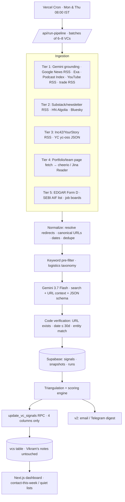

# Signal Sources Reference

> Reference for Claude Code. Rules live in `CLAUDE.md`; tasks live in `docs/build-plan.md`.
> Read only the section you need for the current task.
> **Context:** Vikram, first-time founder, B2B logistics SaaS, raising Seed.
> **Constraints:** Gemini Flash only · Vercel · Supabase · live data · never overwrite Vikram's manual columns.
> **Research verified:** 11 October 2026. If an endpoint or limit behaves differently at runtime, stop and report it.

---

## 0. How to read this file

Every channel has the same five parts: **what it catches**, **tools/endpoints**, **how to query it for logistics**, **limits and gotchas**, and a **verdict**.

| Friction | Meaning |
|---|---|
| 🟢 Low | Public, documented, free endpoint or RSS. Ship it. |
| 🟡 Medium | Needs a key, quota management, or HTML parsing. |
| 🔴 High | Paid, approval-gated, or closing down. |
| ⛔ No-go | Only reachable by breaking a platform's terms (login automation, fake accounts, anti-bot evasion). We don't build these. |

**Phase tags:** `v1` = build for the exam submission · `v2` = after the exam · `later` = only once there's revenue.

---

## Source module index

Map from this document to code. `Tier` = source reliability tier used in scoring (§8.1).

| Section | File | Env vars | Mode | Tier | Phase |
|---|---|---|---|---|---|
| 1.1 | `lib/sources/gemini-grounding.ts` (calls `lib/gemini.ts`) | `GEMINI_API_KEY`, `GEMINI_MODEL` | per VC | D→C (depends on source found) | v1 |
| 1.2 | `lib/sources/google-news-rss.ts` | — | per VC | C | v1 |
| 1.3 | `lib/sources/exa.ts` | `EXA_API_KEY` | per VC | C/B | v1 |
| 1.4 | `lib/sources/tavily.ts` | `TAVILY_API_KEY` | per VC, fallback only | C | v1 |
| 1.5 | `lib/sources/gdelt.ts` | — | batch (OR-grouped) | C | v2 |
| 1.6 | `lib/sources/linkedin-indexed.ts` + `lib/linkedin-date.ts` | — | per VC (via Gemini/Exa) | D | v1 |
| 1.7 | `lib/sources/x-timeline.ts` | `X_BEARER_TOKEN` | per VC | D | v2 |
| 1.8 | `lib/sources/podcast-index.ts` | `PODCASTINDEX_API_KEY`, `PODCASTINDEX_API_SECRET` | per VC | B | v1 |
| 1.9 | `lib/sources/youtube.ts` | `YOUTUBE_API_KEY` | channel RSS per VC + ≤1 search per VC | B | v1 |
| 1.10 | `lib/sources/trade-media-rss.ts` | — | batch | C | v1 |
| 2.2 | `lib/sources/rss-feeds.ts` (firm blogs, Substack, Medium) | — | per VC (`vc.rss_url`) | B | v1 |
| 2.1 | `lib/sources/hn.ts` | — | batch | D | v2 |
| 2.3 | `lib/sources/bluesky.ts` | — (search needs `BLUESKY_*`) | per VC | D | v2 |
| 3 | `lib/sources/india-funding-rss.ts` | — | batch | C | v1 |
| 3 | `scripts/seed-vcs.ts`, `scripts/yc-reverse-lookup.ts` | `EXA_API_KEY` | one-off | — | v1 |
| 4.1 | `lib/sources/portfolio-diff.ts` | `JINA_API_KEY` (optional) | per VC | A | v1 |
| 4.2 | `lib/sources/team-diff.ts` | — | per VC | A | v2 |
| 5.1 | `lib/sources/sec-form-d.ts` | `SEC_USER_AGENT` | per VC with `sec_cik` or firm name | A | v1 |
| 5.3 | `lib/sources/sebi-aif.ts` | — | batch | A | v2 |
| 5.4 | `lib/sources/job-boards.ts` | — | per VC | B | v2 |

Implementation notes that apply to every source:
- Use `fetch` with a 10 s timeout (`AbortSignal.timeout(10_000)`) and one retry with backoff on 429/5xx.
- Parse every response with a `zod` schema; on parse failure, log and return `[]`.
- Never call a source from the browser.
- Per-run concurrency: 6 VCs in parallel; GDELT and SEC have their own throttles (1 req/5 s and ≤10 req/s).

---

## 1. What we took from the reference prompt (and what we dropped)

The other assignment's prompt was a generic "VC intelligence scraper." Useful ideas, wrong framing for us.

**Kept and adapted**
- Top-down tiering of channels (macro media → ecosystem hubs → directories → firm-owned pages → regulatory filings).
- **Portfolio page diffing** to catch unannounced investments before the press release. This is the single best idea in it.
- **Team page diffing** (new partner/principal = new capacity to take meetings).
- **SEC Form D / Form ADV** as atomic ground truth for *fund* raises.
- **Job board APIs** (Greenhouse / Lever / Ashby) as hiring signals.
- **LLM extraction into a strict JSON schema** with a confidence score.
- **Triangulation**: low-confidence social signals get upgraded when a high-confidence source corroborates them.

**Dropped**
- "Regardless of anti-scraping difficulty" + GraphQL interception, login-wall bypass, proxy rotation to evade blocks. These are exactly what got Proxycurl sued out of existence (LinkedIn's suit alleged fake accounts and scraping; Proxycurl shut down 4 July 2025). Not worth it for an exam, and fatal for a product.
- Claude Haiku / GPT-4o-mini → replaced by **Gemini 3.7 Flash** (assignment rule).
- Stealth-startup detection, WHOIS, trademark filings → low value for *which VC to email this week*. Parked.
- Generic "all sectors" coverage → everything below is filtered through a **B2B logistics + Seed** lens.

---

## 2. Master signal taxonomy

| Tier | Channel | Key signal for Vikram | Ingestion method | Cost | Friction | Phase |
|---|---|---|---|---|---|---|
| 1 | Google Search (via Gemini grounding) | Any public mention: post, interview, deal, panel | `gemini-3.7-flash` + `googleSearch` + `urlContext` tools, structured output | 5,000 free searches/mo, then $14/1k | 🟢 | v1 |
| 1 | Google News RSS | News mentions of partner/firm | `news.google.com/rss/search?q=...+when:30d` | Free | 🟢 | v1 |
| 1 | Exa | Essays, blog posts, semantic "partner writes about freight" | `POST api.exa.ai/search` with date filter | $20 signup + $10/mo free | 🟢 | v1 |
| 1 | Tavily | Fallback search + extraction | `POST api.tavily.com/search` | 1,000 credits/mo free | 🟢 | v1 (fallback) |
| 1 | GDELT DOC 2.0 | Global news in 65 languages | `api.gdeltproject.org/api/v2/doc/doc?mode=ArtList` | Free, no key | 🟡 (1 req / 5 s) | v2 |
| 1 | LinkedIn (indirect) | Partner posts on logistics | Search-engine index (`site:linkedin.com/posts`) via Gemini/Exa; activity-ID date decode | Free | 🟡 | v1 |
| 1 | LinkedIn (capture button) | Posts Vikram sees in his own feed | Paste URL / bookmarklet → Gemini classify | Free | 🟢 | v2 |
| 1 | X (official API) | "Excited to back…" posts | Pay-per-use: `GET /2/users/:id/tweets` | ~$0.005/post read | 🟡 | v2 |
| 1 | X (scraper vendors) | Same | Third-party read APIs | Cheap, ToS-grey | ⛔/🔴 | no |
| 1 | Podcasts | Partner interviews | Podcast Index `/search/byperson` | Free (key+secret) | 🟢 | v1 |
| 1 | YouTube | Talks, panels, interviews | Channel RSS (free, no quota) + Data API `search.list` | 10k units/day free | 🟢/🟡 | v1 |
| 1 | Logistics trade media | Deal + exec coverage | FreightWaves / trade RSS + Google News `site:` | Free | 🟢 | v1 |
| 1 | Reddit | — | API approval-gated; RSS ends 13 Nov 2026 | — | 🔴 | no |
| 2 | Hacker News | Logistics launches, VC comments | `hn.algolia.com/api/v1/search_by_date` | Free | 🟢 | v2 |
| 2 | Substack / VC newsletters | Thesis essays, deal roundups | `{name}.substack.com/feed` | Free | 🟢 | v1 |
| 2 | Bluesky | Partner posts | `public.api.bsky.app/xrpc/app.bsky.feed.getAuthorFeed` | Free | 🟢 | v2 |
| 2 | GitHub / Product Hunt | Open-source logistics velocity | GitHub REST API | Free | 🟡 | later (low value) |
| 3 | YC directory | Logistics startups by batch, who backed them | `yc-oss.github.io/api/...` JSON | Free | 🟢 | v1 (seeding) |
| 3 | Signal by NFX | Supply-chain seed investor lists | Public list pages (read, don't crawl at scale) | Free | 🟡 | v1 (seeding) |
| 3 | VC Sheet / OpenVC / Seedtable | Thesis, check size, stage | Manual export / light fetch | Free | 🟡 | v1 (seeding) |
| 3 | Inc42 / YourStory / Entrackr | Indian funding rounds + investors | RSS (`inc42.com/feed/`, `inc42.com/buzz/feed/`, `yourstory.com/feed`) | Free | 🟢 | v1 |
| 4 | Firm `/portfolio` pages | Unannounced logistics investments | Fetch → normalize → hash → diff | Free | 🟡 | v1 |
| 4 | Firm `/team` pages | New partners / principals | Same diff engine | Free | 🟡 | v2 |
| 4 | Firm blogs / partner essays | Thesis updates | RSS or page diff | Free | 🟢 | v1 |
| 5 | SEC EDGAR Form D | US fund closes (fresh capital) | `efts.sec.gov/LATEST/search-index?forms=D` | Free (User-Agent required) | 🟢 | v1 (US VCs) |
| 5 | SEC Form ADV data | AUM shifts | SEC monthly adviser data files | Free | 🟡 | later |
| 5 | SEBI AIF registry | Indian new fund registrations | sebi.gov.in registered AIF list / application status | Free | 🟡 | v2 (India VCs) |
| 5 | Job boards | VC hiring; portfolio hiring | Greenhouse / Lever / Ashby public JSON | Free | 🟢 | v2 |

---

## 3. Channel playbooks

### Tier 1 — Global macro channels

#### 1.1 Gemini grounding (Google Search) — the backbone · 🟢 · v1
- **Catches:** everything public in the last 30 days — posts, interviews, deals, panels, quotes.
- **Tool:** `gemini-3.7-flash` (GA). Since Gemini 3 you can combine `googleSearch` + `urlContext` + structured JSON output in **one call**.
- **Pricing:** 5,000 free grounded searches per month across Gemini 3.x, then $14 per 1,000. Billed **per search query the model runs**, not per prompt — so tell it to run 2–3 focused queries, not 10 broad ones.
- **Gotchas:**
  - Grounded source links come back as `vertexaisearch.cloud.google.com/grounding-api-redirect/...`. Resolve with a `HEAD`/`GET` and store the final URL.
  - Gemini 3 migration notes: drop `temperature`/`top_p`/`top_k` and prefilled model turns.
  - Never trust a model-reported date. Re-verify every date in code (see §8).
- **Logistics query pattern (inside the prompt):**
  ```
  Search for activity in the last 30 days by {partner_name} of {firm}.
  Prioritise: pre-seed/seed investments in B2B logistics or supply-chain SOFTWARE,
  essays/posts about logistics software, podcast or panel appearances, new funds.
  Suggested queries:
   - "{partner_name}" "{firm}" (logistics OR freight OR "supply chain") (SaaS OR software)
   - "{firm}" (seed OR pre-seed) (logistics OR freight OR "supply chain") software
   - site:linkedin.com/posts "{partner_name}" (logistics OR freight OR "supply chain")
  ```

#### 1.2 Google News RSS · 🟢 · v1
- **Endpoint:** `https://news.google.com/rss/search?q=<query>&hl=en-US&gl=US&ceid=US:en`
  - India edition: `&hl=en-IN&gl=IN&ceid=IN:en`
- **Always add `when:30d`** inside `q` — without it, search feeds return months-old stories.
- **Query examples:**
  - `"Santosh Sankar" when:30d`
  - `"Dynamo Ventures" (seed OR invests OR leads) when:30d`
  - `"Stellaris Venture Partners" logistics when:30d` (India edition)
- **Gotchas:** item links are Google redirect URLs (`news.google.com/rss/articles/CBMi...`) — resolve before storing. Don't poll more than a few times a day.

#### 1.3 Exa (semantic search) · 🟢 · v1
- **Why:** best at "find essays/posts where this person talks about freight," which keyword search misses.
- **Free tier:** $20 credits on signup + $10/month, no card.
- **Use:** `category: "news"` for coverage, `category: "people"` (replaced the old `linkedin` category) to resolve the correct profile URL **once per VC at seeding time**. Filter with a start-published-date of `now - 30d`.

#### 1.4 Tavily · 🟢 · v1 fallback
- 1,000 credits/month free, search + extract. Call only when Gemini + Exa + News RSS all return nothing for a VC.

#### 1.5 GDELT DOC 2.0 · 🟡 · v2
- `https://api.gdeltproject.org/api/v2/doc/doc?query=<q>&mode=ArtList&format=json&timespan=30d`
- Free, no key, rolling 3-month window, 65 languages (great for Indian-language business press).
- **Hard limit:** ~1 request per 5 seconds. 50 VCs one-by-one = 4+ minutes → blows the 300 s Vercel limit. **Batch names with `OR`** (e.g. 8 firms per query) or run it as a separate cron.

#### 1.6 LinkedIn — indirect only · v1 / v2
There is **no official API** to read other members' posts. Third-party LinkedIn scrapers carry real legal and continuity risk.

| Approach | Friction | Phase | Notes |
|---|---|---|---|
| Search-engine index: Gemini grounding / Exa with `site:linkedin.com/posts "Partner Name"` | 🟡 | v1 | Reads Google's index, not LinkedIn. Partial coverage. |
| Exa `category:"people"` to pin the right profile URL | 🟢 | v1 | Fixes "which Rahul Mehta?" |
| Cross-posted content (Substack / Medium / firm blog RSS) | 🟢 | v1 | Many partners repost LinkedIn essays. |
| **Capture button**: Vikram pastes a post URL (or clicks a bookmarklet) from his own feed → Gemini classifies & attaches it | 🟢 | v2 | Human-in-the-loop, no crawling. Check LinkedIn's user agreement before productising. |
| Paid public-data vendors (e.g. Bright Data LinkedIn Posts API) | 🔴 | later | Costs money; legal grey; get legal review. |
| Automating Vikram's logged-in account, cookie scrapers, fake accounts | ⛔ | never | ToS violation + account-ban risk on the account he's fundraising with. |

**Exact post date from a URL (community-documented trick):** LinkedIn activity IDs encode creation time in their first 41 bits.
```ts
// e.g. https://www.linkedin.com/posts/...-activity-7288649543976443906-xxxx
export function linkedinActivityDate(activityId: string): Date | null {
  try {
    const bits = BigInt(activityId).toString(2);
    const ms = parseInt(bits.slice(0, 41), 2);
    const d = new Date(ms);
    return d.getFullYear() > 2010 && d <= new Date() ? d : null; // sanity check
  } catch { return null; }
}
```
Unofficial — fall back to the snippet's relative date if it fails.

#### 1.7 X (Twitter) · 🟡 · v2
- **Status (2026):** free tier closed to new developers on 6 Feb 2026; **pay-per-use** is the default. Reads ≈ **$0.005 per post**, user lookups ≈ $0.010, capped at 2M post reads/month. Search covers only the last 7 days.
- **Cheapest legit pattern:** store each VC's X user ID once; on each run call the user-timeline endpoint with `since_id` so you only pay for *new* posts. 50 VCs × ~15 new posts/week ≈ 3,000 reads/month ≈ **~$15/month**.
- **Skip:** third-party "X scraper" APIs (cheap, but ToS-grey and fragile). Nitter-style mirrors are dead.

#### 1.8 Podcasts · 🟢 · v1
- **Podcast Index** (free key + secret): `GET https://api.podcastindex.org/api/1.0/search/byperson?q=<name>`
  - Auth headers: `X-Auth-Key`, `X-Auth-Date` (unix seconds), `Authorization = sha1(key + secret + date)`, plus a `User-Agent`.
- **Listen Notes** — bigger index, but free plan is only 300 requests/month. Use for spot checks.
- **Logistics podcasts worth subscribing to as RSS (guests = signals):**
  - *The Future of Supply Chain* — Dynamo Ventures (host Santosh Sankar; frequent VC guests, e.g. Schematic's Julian Counihan, Primary's Zach Fredericks)
  - *Fuller Speed Ahead* — FreightWaves CEO Craig Fuller
  - *What The Truck?!?* / FreightCasts network — FreightWaves
  - *The Logistics of Logistics* — Joe Lynch
  - *Supply Chain Now* — Scott Luton, Greg White
  - *The Full Ratchet* — VC-focused; has hosted supply-chain investors
- **How:** pull each show's RSS, run guest names through entity matching against the 50 VCs.

#### 1.9 YouTube · 🟢/🟡 · v1
- **Free + unlimited:** channel RSS `https://www.youtube.com/feeds/videos.xml?channel_id=UC...` for firms/partners with channels, and for FreightWaves TV / conference channels.
- **Data API v3:** 10,000 units/day; `search.list` = 100 units, effectively ~100 searches/day. One search per VC per run fits. Don't create extra Google Cloud projects to multiply quota (ToS violation).

#### 1.10 Logistics trade media · 🟢 · v1
- FreightWaves, Supply Chain Dive, The Loadstar, Logistics Management, JOC, ET Infra (India), Logistics Insider (India).
- **Method:** native RSS where available; otherwise Google News RSS with `site:freightwaves.com "Dynamo Ventures" when:30d`.
- **Why it matters:** trade press covers seed logistics rounds that TechCrunch ignores.

#### 1.11 Reddit · 🔴 · skip
- API requires manual approval under the Responsible Builder Policy; free tier is non-commercial.
- `.json` endpoints killed 30 May 2026. **New public API access requests close 31 Oct 2026; RSS feeds stop 13 Nov 2026.**
- VCs rarely post signal on Reddit anyway. Gemini grounding will surface notable threads through normal search.

### Tier 2 — Ecosystem & developer hubs

#### 2.1 Hacker News · 🟢 · v2
- `https://hn.algolia.com/api/v1/search_by_date?query=freight&tags=story&numericFilters=created_at_i>{unix_30d_ago}`
- Uses: "Show HN" launches in logistics (competitor/peer awareness) and comments by partners who post on HN under their real names.

#### 2.2 Substack & VC newsletters · 🟢 · v1
- Every Substack has `https://{name}.substack.com/feed`. Example: Dynamo's weekly newsletter lives at `dynamo.substack.com` → `dynamo.substack.com/feed`.
- Also add: StrictlyVC, Fortune Term Sheet (deal roundups — parse for logistics rounds + lead investor), FreightWaves newsletters.

#### 2.3 Bluesky · 🟢 · v2
- Author feed (no auth): `https://public.api.bsky.app/xrpc/app.bsky.feed.getAuthorFeed?actor={handle}&limit=50`
- Keyword search (`searchPosts`) now requires a free App Password.

#### 2.4 GitHub / Product Hunt · later
- Useful for dev-tool VCs, weak for B2B logistics SaaS. Park.

### Tier 3 — Investor directories (seeding + enrichment, not weekly signals)

| Source | What it gives | How | Notes |
|---|---|---|---|
| **YC directory (yc-oss API)** | All publicly launched YC companies, filterable by industry/batch/tag | `https://yc-oss.github.io/api/meta.json` → find the supply-chain/logistics industry slug → `industries/<slug>.json`, `batches/<batch>.json` | Unofficial, free, static JSON. Use to map *which logistics startups exist* and, via Gemini, *who backed their seeds*. |
| **Signal by NFX** | "Top Supply Chain Tech Seed Investors" (≈450), pre-seed (≈280), logistics lists, city sub-lists | Public list pages | Read the lists to build the 50-VC shortlist. Don't bulk-crawl. |
| **VC Sheet — Logistics funds** | Curated logistics funds with stage + check size | `vcsheet.com/sheet/logistics-funds` | Good thesis/check-size source. |
| **OpenVC** | Thesis, stages, check sizes | Manual export | Free account. |
| **Seedtable** | Ranked logistics startups (incl. India) with investors | Public pages | Reverse-lookup: logistics startup → its seed investors. |
| **Inc42 / YourStory / Entrackr / StartupTalky** | Indian funding rounds with lead investors | RSS + weekly funding tables | Parse investor names → match against VC list. |
| Crunchbase / Tracxn / Dealroom public pages | Portfolio lists | Gemini grounding reads them | Don't scrape behind paywalls. |

**Reverse-lookup trick (high value):** pull recent *logistics seed rounds* (YC + Inc42 + Seedtable + trade press), extract the investors, and rank them by count. That surfaces VCs who are **actively writing logistics seed checks right now** — the best possible list for Vikram — even if they're not yet on his spreadsheet. Add them as "suggested" rows (system-owned), never into his manual columns.

### Tier 4 — Firm-owned assets (first-party ground truth)

#### 4.1 Portfolio page diffing · 🟡 · v1
Catches logistics investments **before** the press release. Algorithm in §6.

#### 4.2 Team page diffing · 🟡 · v2
New partner/principal → new person who can take a first meeting. Same engine as portfolio diffing, different extractor.

#### 4.3 Partner blogs & essays · 🟢 · v1
- RSS where available (`/feed`, `/rss`, `/atom.xml`, Substack, Medium `medium.com/feed/@handle`).
- No RSS? Diff the essay index page (e.g. `paulgraham.com/articles.html`) — a new link = a new essay.

### Tier 5 — Regulatory & legal ground truth

#### 5.1 SEC EDGAR Form D (US funds) · 🟢 · v1
- **Signal:** a VC firm filing Form D for a **new fund** = fresh capital to deploy → move them up.
- `GET https://efts.sec.gov/LATEST/search-index?q="Dynamo Ventures"&forms=D&dateRange=custom&startdt=2026-09-11&enddt=2026-10-11`
- **Must** send `User-Agent: VCPipeline your-email@domain.com` (generic UA → 403). Stay ≤10 req/s.
- Store each firm's CIK once (`data.sec.gov/submissions/CIK##########.json`) for faster later lookups.
- Note: India has no Form D equivalent — use 5.3 instead.

#### 5.2 SEC Form ADV · later
- SEC publishes monthly adviser data (RIAs and exempt reporting advisers, which includes many VC firms). Useful for AUM trend, not for weekly outreach.

#### 5.3 SEBI AIF registry (Indian funds) · 🟡 · v2
- SEBI publishes the list of registered AIFs and periodic application-status PDFs on sebi.gov.in. A new Category I/II venture fund from a VC on Vikram's list ≈ "fund close" signal.
- Method: fetch the list periodically, diff, match firm names.

#### 5.4 Job board APIs · 🟢 · v2
- Greenhouse: `https://boards-api.greenhouse.io/v1/boards/{board}/jobs`
- Lever: `https://api.lever.co/v0/postings/{company}?mode=json`
- Ashby: `https://api.ashbyhq.com/posting-api/job-board/{name}`
- **VC hiring an associate/principal** = expanding investment capacity. **A VC's logistics portfolio companies hiring heavily** = the fund's logistics bets are working → they'll want more.

---

## 4. The logistics lens

### 4.0 What "fit" means for Vikram (apply everywhere)
A signal is only "direct" when it matches **all three** axes. Classify every signal on each axis separately.

| Axis | ✅ Fit | ⚠️ Partial | ❌ Not fit |
|---|---|---|---|
| **Sector** | Logistics / freight / supply-chain operations | Manufacturing, mobility, industrial, general B2B SaaS | Anything else |
| **Customer (business model)** | **B2B**: shippers, carriers, brokers, 3PLs, forwarders, fleets, warehouses | B2B2C (e.g. software sold to D2C brands' fulfilment teams) | **B2C**: consumer delivery, quick commerce, ride-hailing, e-bike rental, consumer parcel apps |
| **Offering** | **Software / SaaS / data / AI tooling** | Software-led marketplaces, tech-enabled services, fintech for logistics | Hardware, drones, robotics, AVs, EVs, asset-heavy fleets/warehouses |
| **Stage** | Pre-seed, seed, seed-extension | Series A | Series B and later, growth, debt-only |

Examples:
- Seed round for a TMS for mid-size Indian shippers → Sector ✅ Customer ✅ Offering ✅ Stage ✅ → **direct**
- Partner essay "AI agents will replace freight-broker back offices" → Sector ✅ Customer ✅ Offering ✅ (no stage) → **direct** (thesis)
- Series A in warehouse robotics → Sector ✅ Customer ✅ Offering ❌ Stage ⚠️ → **adjacent**
- Seed round for a consumer parcel-delivery app → Sector ✅ Customer ❌ → **adjacent**
- Series C in an e-bike rental company → **unrelated** for Vikram (still proves the fund is active)


### 4.1 Relevance keyword taxonomy (feed to Gemini + use for a cheap pre-filter)
| Bucket | Terms |
|---|---|
| Core software | TMS, WMS, YMS, freight audit & pay, visibility, control tower, route optimization, dock scheduling, load board, rate management, procurement |
| Modes | FTL, LTL, drayage, intermodal, ocean freight, air cargo, parcel, last mile, middle mile, cross-border, customs |
| Players | shipper, carrier, 3PL, 4PL, freight broker, forwarder, fleet operator |
| Adjacent | cold chain, warehouse automation, robotics, telematics, supply chain finance, reverse logistics, AI agents for logistics |
| India-specific | ULIP, PM Gati Shakti, National Logistics Policy, e-way bill, FASTag, ONDC logistics, kirana distribution |
| B2B markers (boost) | shippers, enterprise, SMB logistics teams, SaaS, ARR, workflow, API, ERP integration, procurement teams |
| B2C / non-software markers (route to adjacent, don't drop) | consumer app, quick commerce, 10-minute delivery, ride-hailing, e-bike/EV rental, drones, robots, autonomous trucks, fleet ownership |

### 4.2 Seed-stage keywords (cheap pre-filter only)
Terms that suggest seed appetite: *pre-seed, seed, first check, first institutional, lead, $500K–$3M, ₹4–25 Cr*. The actual stage weighting happens in §4.4 using the extracted `round_stage`.

### 4.3 Relevance tiers (derived from §4.0 in code, not chosen freely by the model)
| Level | Rule | Multiplier |
|---|---|---|
| Direct | Sector ✅ + Customer ✅ + Offering ✅ | ×1.5 |
| Thematic | Sector ✅ + Customer ✅/⚠️ + Offering ⚠️ (e.g. logistics fintech, software-led marketplace) | ×1.2 |
| Adjacent | Sector ✅ but Customer ❌ or Offering ❌; or Sector ⚠️ with B2B software | ×0.6 |
| Unrelated | Everything else | ×0.15 (proves the fund is active, nothing more) |

### 4.4 Stage multiplier (applies to investments and fund-related signals)
| Round stage of the deal | Multiplier |
|---|---|
| pre-seed / seed / seed-extension | ×1.3 |
| series-a | ×1.0 |
| series-b or later / growth / debt | ×0.5 |
| unknown or not a deal (essay, podcast, event) | ×1.0 |

### 4.5 Firm-level fit (static, computed once at seeding, refreshed monthly)
Stored in `vc_profiles` (system table, §DB). One Gemini call per VC with URL context on the firm's site + portfolio page.

| Field | Values | Multiplier on the VC's final score |
|---|---|---|
| `does_seed` | `leads_seed` · `participates_seed` · `series_a_plus_only` · `unknown` | 1.15 · 1.0 · 0.5 · 0.9 |
| `b2b_logistics_thesis` | `core` (dedicated supply-chain fund) · `explicit` (named in thesis) · `portfolio_only` (has deals, no stated thesis) · `none` | 1.2 · 1.1 · 1.0 · 0.7 |
| `investor_type` | `seed_fund` · `multi_stage` · `cvc_strategic` · `angel_syndicate` · `accelerator` | 1.0 · 0.9 · 0.6 · 0.9 · 1.0 |
| `typical_check` | free text, e.g. "$500K–$2M" | info only (shown on dashboard) |
| `geo_focus` | free text, e.g. "US, India" | info only; flag mismatch with Vikram's geo |

---

## 5. Watchlist seeds

> These are **starting points to verify**, not a final list. Confirm each fund is still active and still doing seed before adding.

### 5.1 Logistics-specialist and logistics-active seed funds (global / US) — ≈15 slots; prefer funds that invest outside North America
Fit legend: **Seed fit** ✅ leads/participates in seed · ⚠️ seed possible but not core · ❌ context only (track for thematic signals, don't prioritise outreach).

| Fund | Seed fit | Why it's on the list |
|---|---|---|
| **Dynamo Ventures** | ✅ | Pre-seed/seed, supply chain & mobility; raised a $54M Fund III (May 2025); checks reported ~$1.25M–$2.5M; portfolio incl. Stord, Gatik, Sennder, Raft, Verusen. Runs a podcast + newsletter (great signal surfaces). |
| **Schematic Ventures** | ✅ | Seed specialist for supply chain, manufacturing, commerce infrastructure. |
| **Ironspring Ventures** | ⚠️ | Industrial/supply chain. Sources differ: some list seed checks, VC Sheet describes post-seed/Series A leads with $2–4M checks. Verify current stage before prioritising. |
| **8VC** | ⚠️ multi-stage | Frequently cited as one of the most active freight-tech investors. |
| **Primary Venture Partners** | ✅ | Seed fund; has a partner focused on supply chain (Zach Fredericks). |
| Chicago Ventures, Susa Ventures, Overlay Capital, Newlab, REFASHIOND, Mu Ventures, Tech Square Ventures | verify | Recurring names on logistics seed lists; confirm each one's current stage and B2B software focus. |
| Strategics: Prologis Ventures, Maersk Growth, UPS Ventures, FedEx Ventures, DHL | ❌ context | Corporate VCs, usually later-stage. Track for thematic signals only; `investor_type = cvc_strategic`. |

### 5.2 India (primary market — see `docs/assumptions.md` A2)
| Fund | Seed fit | Notes |
|---|---|---|
| Blume Ventures | ✅ | Most consistent India seed writer in 2026 rankings. |
| Stellaris Venture Partners | ✅ | Seed checks ~$1–2M; focus includes B2B SaaS and supply chain tech. |
| Nexus Venture Partners | ⚠️ | Few seed deals in 2026; SaaS/enterprise skew; co-invests with Stellaris/Blume. |
| Matrix Partners India (now Z47) | ⚠️ | Historically active in logistics; seed pace slowed in 2026. |
| Orios Venture Partners | ⚠️ | Consumer, fintech, logistics; smaller seed checks — check B2B fit per deal. |
| NB Ventures, Enrission India Capital, Navyug Global | verify | Led 2026 Indian logistics-tech seed rounds (Edgistify, Hexalog, TOCAL). Confirm each company is B2B software before treating as direct. |
| Inflection Point Ventures | ⚠️ | Angel network; its 2026 logistics deal (Daakit) was tagged *consumer* logistics — adjacent, not direct. |

### 5.3 "Paul Graham–type" voices to track
People whose writing/talking moves the conversation. Their posts are signals in two ways: (a) if they're investors, a direct signal; (b) if they amplify a theme, investors on the list tend to follow.

| Person | Role | Where they publish | Why |
|---|---|---|---|
| **Paul Graham** | YC co-founder | paulgraham.com essays (diff `articles.html`), X | General founder/fundraising thinking; YC companies in logistics are the reverse-lookup seed. |
| **Santosh Sankar** | Co-founder & MP, Dynamo Ventures | *Future of Supply Chain* podcast, Dynamo Substack | The closest thing to a "PG of supply-chain seed." |
| **Julian Counihan** | GP, Schematic Ventures | Podcasts, essays | Supply chain / warehouse automation seed investor. |
| **Ryan Petersen** | Flexport founder/CEO; venture partner at Founders Fund (since 2023) | X, interviews | Both operator and investor — his investment posts are direct signals. |
| **Craig Fuller** | FreightWaves founder/CEO | *Fuller Speed Ahead*, FreightWaves columns, X (@FreightAlley) | Sets the freight-tech news agenda; guests are often investors. |
| **Joe Lonsdale** | 8VC founder | X, essays, podcasts | 8VC is a top freight-tech investor. |
| **Zach Fredericks** | Primary Venture Partners | Podcasts, LinkedIn | Supply-chain-focused partner at a seed fund. |
| **Joe Lynch** / **Scott Luton** / **Greg White** | Podcast hosts (Logistics of Logistics; Supply Chain Now) | Podcasts | Hosts, not VCs — use their guest lists to discover investors. |

### 5.4 Events (speaker lists = "appeared at" signals)
- **Manifest Vegas 2027** — 8–10 Feb 2027, The Venetian, Las Vegas; ~400 speakers incl. investors (early list includes Woven Capital and Sageview Capital partners). Fetch the public speaker page weekly and diff it.
- FreightWaves events (Future of Supply Chain), ProMat/MODEX, CSCMP EDGE, plus Indian logistics/warehousing shows.
- **Signal timing:** "announced as speaker" (upcoming) and "spoke at" (past 30 days) are both valid hooks for outreach.

---

## 6. Portfolio & team diffing algorithm

**Goal:** detect a new logistics company on a VC's `/portfolio` page before it's announced.

**Runtime reality on Vercel:** full Playwright/Chromium is heavy in serverless. Use this ladder:
1. `fetch` + `cheerio` (works for most static portfolio pages).
2. If the page is JS-rendered (few/no company names in HTML) → **Jina Reader** `https://r.jina.ai/<url>` (renders + returns markdown; 20 RPM keyless, 500 RPM with free key).
3. Only if both fail → a hosted headless browser (v2).

**Steps**
1. **Discover** the URL once per firm: try `/portfolio`, `/companies`, `/investments`; else ask Gemini (URL context) to find it. Store `portfolio_url`.
2. **Fetch politely:** respect `robots.txt`, identify with a real User-Agent, max one fetch per firm per run.
3. **Normalize:** strip scripts/nav/footer; extract candidate company entries (logo `alt` text, card titles, outbound links).
4. **Canonicalize** each entry → `{name_normalized, domain}` (lowercase, strip Inc/Ltd/Technologies, use outbound domain as the strong key).
5. **Hash** the sorted set → compare with last snapshot's hash. Same hash → done.
6. **Diff** sets: `added = now − before`, `removed = before − now`.
7. **Debounce:** require an addition to appear in **2 consecutive runs** before alerting (filters A/B tests and broken renders).
8. **Enrich** each added company with one Gemini call (URL context on its domain) returning the §4.0 axes: sector, customer (B2B/B2C), offering (software/hardware/...), round stage. Only B2B logistics **software** additions get `logistics_relevance = direct`.
9. **Emit signal** `type: "portfolio_addition"`, `source_tier: 4`, with evidence = snapshot diff.
10. **Store** snapshots in `portfolio_snapshots` (system table) — never touch Vikram's columns.

```ts
type Entry = { name: string; domain?: string };

function canonical(e: Entry) {
  const name = e.name.toLowerCase()
    .replace(/\b(inc|llc|ltd|pvt|technologies|technology|labs|ai)\b\.?/g, "")
    .replace(/[^a-z0-9]/g, "");
  return e.domain ? e.domain.replace(/^www\./, "").toLowerCase() : name;
}

export function diffPortfolio(prev: Entry[], curr: Entry[]) {
  const p = new Map(prev.map(e => [canonical(e), e]));
  const c = new Map(curr.map(e => [canonical(e), e]));
  const added = [...c.keys()].filter(k => !p.has(k)).map(k => c.get(k)!);
  const removed = [...p.keys()].filter(k => !c.has(k)).map(k => p.get(k)!);
  return { added, removed };
}
```

---

## 7. Gemini extraction: schema + prompt

### 7.1 Signal JSON schema (`responseSchema`)
```json
{
  "type": "object",
  "properties": {
    "vc_id": { "type": "string" },
    "is_same_person_or_firm": { "type": "boolean" },
    "signals": {
      "type": "array",
      "items": {
        "type": "object",
        "properties": {
          "signal_type": { "type": "string", "enum": ["investment", "writing", "interview", "event", "fund_close", "team_change", "social_post", "other"] },
          "title": { "type": "string" },
          "summary_one_line": { "type": "string" },
          "source_url": { "type": "string" },
          "published_date": { "type": "string", "description": "YYYY-MM-DD as stated on the page; empty if unknown" },
          "evidence_quote": { "type": "string", "description": "<=25 words copied from the page proving the claim" },
          "company_name": { "type": "string" },
          "round_stage": { "type": "string", "enum": ["pre-seed", "seed", "seed-extension", "series-a", "series-b-plus", "debt", "not-a-deal", "unknown"] },
          "sector_fit": { "type": "string", "enum": ["fit", "partial", "none"] },
          "customer_type": { "type": "string", "enum": ["b2b", "b2b2c", "b2c", "unknown"] },
          "offering_type": { "type": "string", "enum": ["software", "marketplace", "services", "fintech", "hardware", "asset_heavy", "not_applicable", "unknown"] },
          "check_size": { "type": "string" },
          "opening_line": { "type": "string", "description": "<=30 words, only facts from the evidence; empty unless direct or thematic" },
          "nudge_line": { "type": "string", "description": "<=30 words follow-up referencing the new signal; empty unless direct or thematic" },
          "confidence": { "type": "number", "minimum": 0, "maximum": 1 }
        },
        "required": ["signal_type", "summary_one_line", "source_url", "round_stage", "sector_fit", "customer_type", "offering_type", "confidence"]
      }
    }
  },
  "required": ["vc_id", "is_same_person_or_firm", "signals"]
}
```

> `logistics_relevance` is **not** asked of the model. `lib/score.ts` derives it from `sector_fit` + `customer_type` + `offering_type` using §4.3, so the rule is deterministic and testable.

> Rules for `opening_line` and `nudge_line` are in `docs/dashboard-design.md` §7.

### 7.2 Prompt template
```
You are a research analyst for a founder raising a SEED round for a B2B logistics SaaS.

FOUNDER CONTEXT
- B2B logistics SaaS, raising Seed. Most valuable: evidence this investor is actively
  backing or thinking about B2B logistics SOFTWARE at pre-seed/seed.
- Still report unrelated activity (it shows the investor is active), but classify it honestly.

INVESTOR
- Partner: {partner_name}
- Firm: {firm}
- Known profile URLs: {linkedin_url} {x_handle} {blog_url}
- Stated thesis: {thesis}

CANDIDATE ITEMS (already collected from RSS, news, podcasts, filings)
{items_as_numbered_list_with_url_date_snippet}

TASK
1. Use Google Search and URL context to find anything else from the LAST 30 DAYS
   (today is {today}) by this partner or firm.
2. For each item, confirm it is about THIS partner/firm (not a namesake).
3. For each signal, classify separately:
   sector_fit: fit = logistics/freight/supply-chain operations;
               partial = manufacturing, mobility, industrial, general B2B SaaS; none = other
   customer_type: b2b = sells to shippers, carriers, brokers, 3PLs, forwarders, fleets,
                  warehouses or enterprise ops teams; b2c = sells to consumers
                  (delivery apps, quick commerce, ride-hailing, e-bike rental)
   offering_type: software = SaaS/data/AI tools; hardware = drones, robots, vehicles,
                  devices; asset_heavy = owns fleets/warehouses; marketplace/services/fintech
                  as named; not_applicable for essays/podcasts/events without a company
   round_stage: the stage of the deal mentioned; "not-a-deal" for essays, talks, posts
   An essay or talk about B2B logistics software counts as sector_fit=fit,
   customer_type=b2b, offering_type=software.
4. Copy a short evidence quote from the source.

RULES
- Only include items with a real source URL.
- If you cannot find a publish date on the page, leave published_date empty. Do not guess.
- If nothing qualifies, return an empty signals array. That is a valid, useful answer.
- Output JSON only, matching the schema.
```

### 7.3 Post-processing (in code, never trusted to the model)
- Drop items with no URL; resolve redirect URLs.
- Recompute the date: page metadata → RSS `pubDate` → LinkedIn activity-ID decode → model's value. Reject anything older than 30 days.
- Dedupe by canonical URL, then by `(company_name, signal_type)` within 7 days.

---

## 8. Triangulation & scoring

### 8.1 Source reliability tiers
| Tier | Sources | Base confidence |
|---|---|---|
| A — atomic | SEC Form D, SEBI AIF list, firm's own portfolio/team page diff | 0.95 |
| B — first-party | Partner's own blog/Substack/podcast appearance, firm press release | 0.85 |
| C — reported | Trade press, Inc42/YourStory, Google News | 0.75 |
| D — social/indirect | Search-indexed LinkedIn/X/Bluesky posts | 0.55 |

### 8.2 Corroboration rules
- **Upgrade:** a D-tier signal ("excited to back X") + any A/B/C signal on the same company within 14 days → treat as B-tier confirmed.
- **Investment confirmed:** portfolio diff addition + trade-press round → highest-value signal.
- **Fund close:** Form D/SEBI + news → "fresh fund" flag for 60 days.
- **Conflict:** model says investment, but the company isn't on the portfolio page after 2 runs and no press exists → cap confidence at 0.5.

### 8.3 Follow-up score (0–100)
```
signal_value = type_weight × relevance_multiplier × stage_multiplier × confidence × recency_decay

type_weight:  investment 40 · fund_close 35 · writing 25 · interview 22 · event 18 · team_change 15 · social_post 12
relevance:    from §4.3 (direct 1.5 · thematic 1.2 · adjacent 0.6 · unrelated 0.15)
stage:        from §4.4 (seed 1.3 · series-a 1.0 · later 0.5 · not-a-deal 1.0)
recency:      exp(-days_ago / 14)          # ~50% after 10 days

raw       = sum(top 3 signal_values) + (10 if ≥2 independent sources agree)
firm_fit  = does_seed_mult × thesis_mult × investor_type_mult      # §4.5, from vc_profiles
follow_up_score = min(100, round(raw × firm_fit))

Guardrail: if no signal in the last 30 days is direct or thematic, cap follow_up_score at 45
(an active-but-off-thesis VC is never "reach out this week").
```

### 8.4 Recommended action (combines score with Vikram's pipeline status)
| Score | Status = yet to reach out | Status = waiting for response |
|---|---|---|
| ≥ 60 | **Reach out this week** — open with the signal | **Nudge now** — reference the signal as the reason |
| 30–59 | Reach out if capacity allows | Light nudge if last contact > 14 days |
| < 30 / no signal | **Quiet: deprioritize this week** | Hold; re-check next run |

`signal_summary` must lead with the best **direct/thematic** signal, e.g. "Led seed in FreightFox (B2B freight procurement SaaS), 6 days ago". If only unrelated activity exists, say so: "Active, but no B2B logistics signal (last: Series C in an e-bike rental co.)".

Only these system columns are written: `last_signal_date`, `signal_summary`, `follow_up_score`, `recommended_action` (via a column-restricted RPC).

---

## 9. Pipeline architecture



### 9.1 Supabase tables (system-owned unless noted)
| Table | Purpose |
|---|---|
| `vcs` | **Mixed.** Vikram-owned: name, firm, thesis, status, last_contact_date, personal_notes, contact_history. System-owned: last_signal_date, signal_summary, follow_up_score, recommended_action, plus identifiers (rss_url, portfolio_url, x_user_id, bluesky_handle, youtube_channel_id, sec_cik, linkedin_url). |
| `signals` | Every verified signal with source tier, URL, date, evidence, relevance, confidence. Full history. |
| `portfolio_snapshots` | Canonical entry sets + hash per firm per run. |
| `pipeline_runs` | Run log: started/ended, per-VC errors, API usage counts. |
| `suggested_vcs` | VCs discovered via reverse-lookup that aren't on Vikram's list yet. |

---

## DB. Database schema, column ownership, and the protected RPC

Put this in `supabase/migrations/`. The function runs as a dedicated role that has **column-level UPDATE rights only on the four signal columns**, so even a bug in app code cannot overwrite Vikram's notes.

```sql
-- vcs: mixed ownership. Comments mark who owns each column.
create table if not exists public.vcs (
  id uuid primary key default gen_random_uuid(),
  -- Vikram-owned (system NEVER writes these)
  name text not null,
  firm text not null,
  thesis text,
  status text check (status in ('waiting_for_response','yet_to_reach_out')),
  last_contact_date date,
  contact_history text,
  personal_notes text,
  -- System-owned signal columns (written ONLY via update_vc_signals)
  last_signal_date date,
  signal_summary text,
  follow_up_score int check (follow_up_score between 0 and 100),
  recommended_action text,
  -- System-owned identifiers (set by scripts/seed-vcs.ts, separate RPC)
  linkedin_url text,
  x_user_id text,
  bluesky_handle text,
  youtube_channel_id text,
  rss_url text,
  portfolio_url text,
  team_url text,
  sec_cik text,
  -- (priority, region, partner_name, needs_review are added in docs/components-map.md §3.6)
  updated_by_system_at timestamptz
);

create table if not exists public.signals (
  id bigserial primary key,
  vc_id uuid references public.vcs(id) on delete cascade,
  signal_type text not null,
  summary text not null,
  source_url text not null,
  source_name text not null,
  source_tier text not null check (source_tier in ('A','B','C','D')),
  published_date date not null,
  evidence_quote text,
  company_name text,
  round_stage text,
  sector_fit text,
  customer_type text,
  offering_type text,
  logistics_relevance text not null,   -- derived in lib/score.ts from the three fields above
  confidence numeric not null,
  created_at timestamptz default now(),
  unique (vc_id, source_url)
);

create table if not exists public.portfolio_snapshots (
  id bigserial primary key,
  vc_id uuid references public.vcs(id) on delete cascade,
  kind text not null check (kind in ('portfolio','team')),
  entries jsonb not null,
  entries_hash text not null,
  captured_at timestamptz default now()
);

create table if not exists public.pipeline_runs (
  id bigserial primary key,
  started_at timestamptz default now(),
  finished_at timestamptz,
  trigger text,
  vcs_processed int default 0,
  errors jsonb default '[]'::jsonb,
  usage jsonb default '{}'::jsonb
);

create table if not exists public.vc_profiles (
  vc_id uuid primary key references public.vcs(id) on delete cascade,
  does_seed text check (does_seed in ('leads_seed','participates_seed','series_a_plus_only','unknown')),
  b2b_logistics_thesis text check (b2b_logistics_thesis in ('core','explicit','portfolio_only','none')),
  investor_type text check (investor_type in ('seed_fund','multi_stage','cvc_strategic','angel_syndicate','accelerator')),
  typical_check text,
  geo_focus text,
  evidence_urls text[],
  profiled_at timestamptz default now()
);

create table if not exists public.suggested_vcs (
  id bigserial primary key,
  firm text not null,
  partner_name text,
  reason text,
  evidence_urls text[],
  created_at timestamptz default now(),
  unique (firm, partner_name)
);

-- Dedicated low-privilege role that owns the write function
do $$ begin
  if not exists (select 1 from pg_roles where rolname = 'pipeline_writer') then
    create role pipeline_writer nologin;
  end if;
end $$;
grant pipeline_writer to postgres;
grant usage on schema public to pipeline_writer;
grant select (id, last_signal_date) on public.vcs to pipeline_writer;
grant update (last_signal_date, signal_summary, follow_up_score,
              recommended_action, updated_by_system_at)
  on public.vcs to pipeline_writer;

create or replace function public.update_vc_signals(
  p_id uuid,
  p_last_signal_date date,
  p_signal_summary text,
  p_follow_up_score int,
  p_recommended_action text
) returns void
language sql
security definer
set search_path = public
as $$
  update public.vcs set
    last_signal_date     = coalesce(p_last_signal_date, last_signal_date), -- keep old date if no new signal
    signal_summary       = p_signal_summary,
    follow_up_score      = p_follow_up_score,
    recommended_action   = p_recommended_action,
    updated_by_system_at = now()
  where id = p_id;
$$;

alter function public.update_vc_signals(uuid, date, text, int, text) owner to pipeline_writer;
revoke all on function public.update_vc_signals(uuid, date, text, int, text) from public, anon, authenticated;
grant execute on function public.update_vc_signals(uuid, date, text, int, text) to service_role;
```

Notes:
- The `coalesce` on `last_signal_date` means a quiet week keeps the last real signal date instead of wiping it.
- Identifier columns get their own RPC (`update_vc_identifiers`) built the same way, used only by `scripts/seed-vcs.ts`.
- `postgres` must be a member of `pipeline_writer` to transfer function ownership (the `grant` above handles it). If Supabase rejects any statement, report it rather than loosening the grants.

### Acceptance test: manual columns untouched
Run in the Supabase SQL editor (or as an integration test):
```sql
-- 1. Proof the role cannot touch manual columns (must ERROR: permission denied)
set role pipeline_writer;
update public.vcs set personal_notes = 'overwritten' where true;
reset role;

-- 2. End-to-end: set a note, run the pipeline, confirm the note is identical
update public.vcs set personal_notes = 'TEST-NOTE-123' where name = '<a VC>';
-- trigger /api/run-now, then:
select personal_notes, signal_summary, updated_by_system_at from public.vcs where name = '<a VC>';
```

---

## 10. Monthly budget (50 VCs, ~9 runs/month)

| Service | Usage | Free allowance | Expected cost |
|---|---|---|---|
| Gemini grounding | ~3 searches × 50 × 9 ≈ 1,350 | 5,000/mo | $0 |
| Gemini tokens (Flash) | ~450 calls | paid key | a few dollars at most |
| Exa | ~450 searches | $10/mo credit | $0 |
| Tavily | fallback only | 1,000 credits/mo | $0 |
| YouTube Data API | ≤50 searches/run | ~100 searches/day | $0 |
| Podcast Index, RSS, EDGAR, HN, Bluesky, yc-oss | — | free | $0 |
| X API (v2, optional) | ~3,000 post reads | none | ~$15 |
| Vercel Hobby | 2 cron runs/week, ≤300 s each | free (non-commercial only) | $0 → Pro when it becomes a SaaS |

---

## 11. Don't-do list

- ❌ Automate Vikram's (or anyone's) logged-in LinkedIn/X session, use cookie scrapers, or create fake accounts.
- ❌ Rotate proxies or solve CAPTCHAs to get around a site's blocks.
- ❌ Build on Reddit RSS/API (closing Nov 2026 → Mar 2027).
- ❌ Use NewsAPI.org's free tier in production (dev/localhost only).
- ❌ Trust model-reported dates or URLs without verifying in code.
- ❌ Upsert full rows into `vcs` — always go through the column-restricted RPC.
- ❌ Multiply free quotas with extra projects/accounts (YouTube explicitly forbids it).

---

## 12. Build order

See `docs/build-plan.md`.
